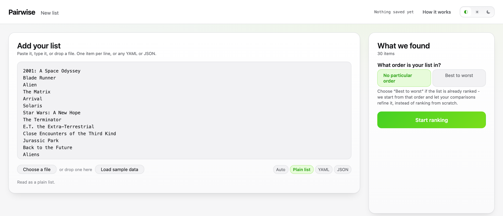
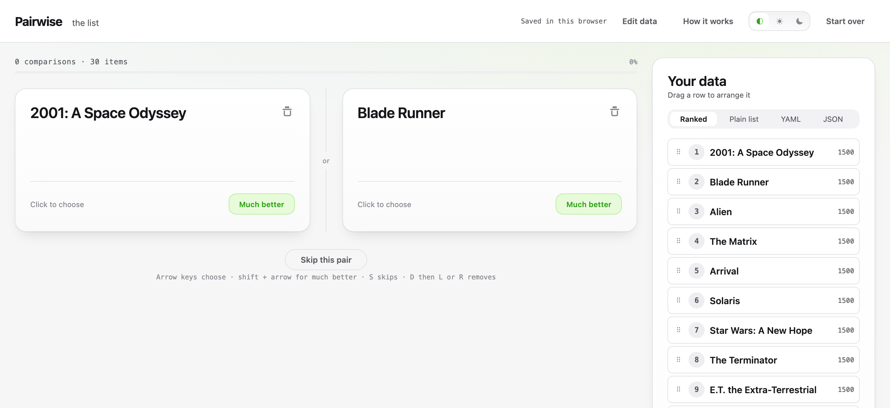
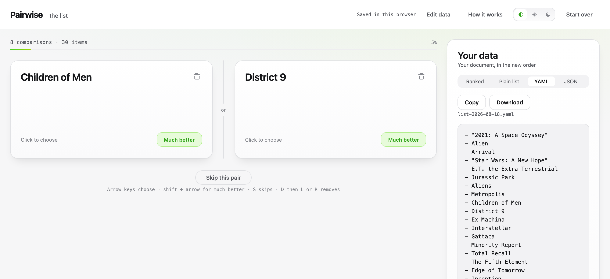

# Pairwise List Ranker

Rank any list by comparing two items at a time. Paste a list of movies, books,
candidates, features, whatever needs ordering, then just pick the better one
of each pair. The full ranking falls out of a handful of quick comparisons.

**[Try the live demo →](https://pairwise.apps.davidfuchs.ca/)**

No accounts, no backend, no database, no sharing. Everything runs in your
browser, and your data never leaves it.



## How it works

**1. Add your list.** Paste plain text (one item per line) or drop in YAML or
JSON for richer data. The app figures out the format and shows you what it
found before anything happens.

**2. Compare, pair by pair.** Two items, one click. Pick the better one, mark
it as much better, skip the pair, or delete an item outright. A progress meter
tracks how close the ranking is to settled.



**3. Export the result.** The ranked list is always one click away, as plain
text, YAML, or JSON, matching whatever format you imported. Copy it or
download it.



## Why pairwise comparison

Sorting a list of 30 things by dragging them into order is tedious and
error-prone. Judging two things against each other is easy. This app uses
that: every choice you make feeds a weighted Elo ranking, so the order
converges quickly and keeps refining itself the longer you compare.

- import a simple list or a list of complex objects
- compare two items at a time
- pick the better item, mark one as much better, skip, or delete
- converge on a ranked list over repeated pairwise comparisons
- preview and export the current list as plain text, YAML, or JSON
- optionally keep the working state locally in the browser, so a reload
  doesn't lose your progress

## Getting started

```bash
npm install
npm run web        # dev server
npm run build:web  # static bundle in dist/
```

## Scripts

| Script | What it does |
| --- | --- |
| `npm run web` | Expo dev server for the web app |
| `npm run build:web` | Static export to `dist/` |
| `npm run test` | Unit, component, and integration suites (Vitest) |
| `npm run e2e` | Builds, then runs Playwright against the static build |
| `npm run typecheck` | `tsc --noEmit` |
| `npm run lint` | ESLint |

Docker, for self-hosting the static build:

```bash
docker compose up --build   # http://localhost:8080
```

## Under the hood

- **Ranking** is weighted Elo ([lib/ranking/](lib/ranking/)). Comparison
  history is append-only, and the displayed order is rebuilt from that
  history, so the ranking is reproducible rather than incrementally patched.
- **Import and export** share one pipeline ([lib/import/](lib/import/),
  [lib/export/](lib/export/)). A plain list, YAML, or JSON document all
  resolve to the same shape internally, and export returns the user's own
  document with the ranked array reordered in place, every other key
  untouched.
- **State** lives in a Zustand store ([lib/state/](lib/state/)) with an
  optional `localStorage` snapshot. Exported files are the durable artifact;
  browser storage is a convenience.

A behavior worth knowing: deleting an item during a comparison records no
result for that pair, but ratings already earned against a deleted item are
kept.

## Documentation

- [PLAN.md](PLAN.md) - implementation plan by phase
- [ARCHITECTURE.md](ARCHITECTURE.md) - data model, ranking design, formats
- [UX.md](UX.md) - layout, visual system, interaction model
- [docs/DEPLOYMENT.md](docs/DEPLOYMENT.md) - building, hosting, and where user data lives
- [docs/QA.md](docs/QA.md) - manual QA pass before a release

## License

[MIT](LICENSE)
