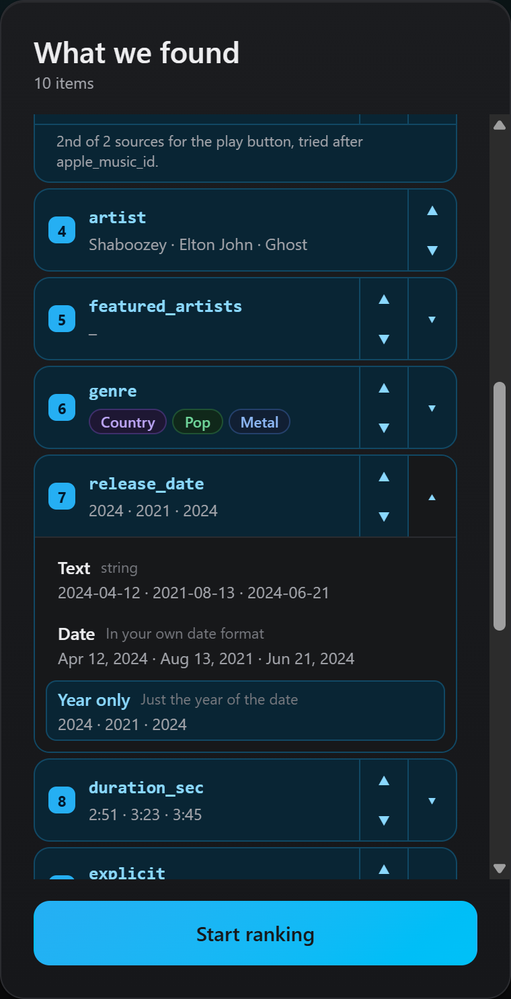
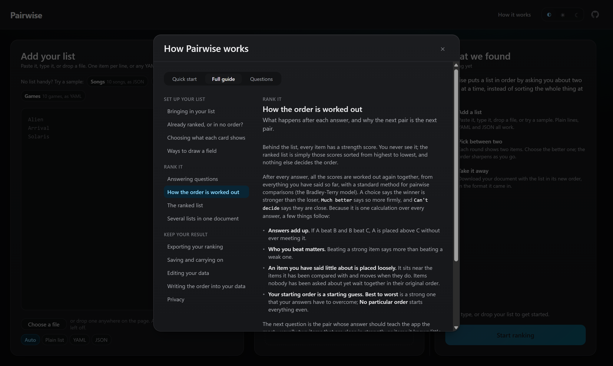

# Pairwise List Ranker

Rank any list by comparing two items at a time. Paste a list of songs, movies,
books, candidates, features, whatever needs ordering, then just pick the
better one of each pair. The full ranking falls out of a handful of quick
comparisons.

**[Try the live demo →](https://pairwise.apps.davidfuchs.ca/)**

No accounts, no backend, no database, no sharing. Everything runs in your
browser, and your data never leaves it.


## How it works

**1. Add your list.** Paste plain text (one item per line), or drop in YAML or
JSON for richer data. The app works out the format and shows what it found
before anything happens. Not sure where to start? The sample buttons load ten
songs, movies or Steam games, already set up to show the cards off.

**2. Choose what each card shows.** For a list of objects, pick the field
that titles each card, tick the details to show under it, and choose how each
one is drawn: album art, a play button, tags, a duration, a badge, and more.

**3. Compare, pair by pair.** Two items, one click. Pick the better one, mark
it as much better, say you can't decide, or remove an item outright. The
ranking reworks itself after every answer.


**4. Take the result with you.** The ranked list is always one click away as
plain text, YAML or JSON - your own document, with the list in its new order.
To carry on later, save the whole session to a single file.


## Features

### Importing

- Plain lists, YAML and JSON, detected automatically, with a manual override.
- Paste, type, choose a file, or drop one anywhere on the page.
- A document with several lists: pick which one to rank. The rest of the
  document is kept exactly as it was and comes back with the export.
- Already ranked? Choose **Best to worst** and comparisons refine your order
  instead of starting from scratch.

### Setting up the cards

One **Fields** list covers every field your items have, each previewed with
its own values:

- **Tap** a field to make it the title. The first field is the title to begin
  with; a title is always shown as it is written in your data.
- **Tick** the box beside a field to show it on every card, as many as you
  like. Nothing is ticked until you tick it.
- **▲ ▼** set the order the details appear in.
- **▾** picks how a field is drawn, with each choice previewed using your data.



A way of drawing a field is offered only when every value the field holds
suits it:

| Renderer            | Offered when every value is…                                                                                             | Drawn as                                                                                                   |
| ------------------- | ------------------------------------------------------------------------------------------------------------------------ | ---------------------------------------------------------------------------------------------------------- |
| Text                | anything                                                                                                                 | the value as written                                                                                       |
| Link                | a web address                                                                                                            | a link that opens in a new tab                                                                             |
| Image               | a link to a `.png`, `.jpg`, `.gif`, `.webp`, `.avif`, `.svg`… file                                                       | a picture beside the title, and a thumbnail in the ranked list                                             |
| Image gallery       | a list of image links (single links allowed among them)                                                                  | the pictures in the same place, with arrows to page through them                                           |
| YouTube thumbnail   | a YouTube video address                                                                                                  | the video's picture, opening the video                                                                     |
| Steam header        | a Steam app id or `store.steampowered.com/app/…` address                                                                 | the game's store banner, opening its store page                                                            |
| Apple Music preview | an Apple Music track id                                                                                                  | a round play button for a 30-second clip                                                                   |
| Deezer preview      | a Deezer track id or `deezer.com/track/…` address                                                                        | the same play button, with Deezer's clip                                                                   |
| Tags                | a list of words or numbers                                                                                               | a row of small labels                                                                                      |
| Pills               | a short word, at most 24 different ones, repeated across items (or any, in a field named like genre, status or category) | a coloured label; the same word is always the same colour, and priorities like high/low keep their meaning |
| Long text           | text, some of it past 80 characters or over several lines                                                                | three lines on a card, with **More** for the rest                                                          |
| Location            | a `{lat, lng}`, `[lat, lng]` or `lat, lng` position, or text in a field named like a place (`address`, `city`, `venue`…) | a link that opens the place on a map                                                                       |
| Flag                | a two-letter country code, like `CA`                                                                                     | the flag and the country's name                                                                            |
| Colour swatch       | a `#hex`, `rgb()` or `hsl()` colour                                                                                      | a square of the colour beside its code                                                                     |
| Currency            | a number, in a currency you pick (USD, CAD, EUR, GBP, AUD, JPY, CHF, INR)                                                | money as written where you are, like `$120,000`                                                            |
| Date / Year only    | a date written year first, like `2024-04-12`                                                                             | `Apr 12, 2024` in your own format, or just `2024`                                                          |
| Duration (seconds)  | a whole number of seconds                                                                                                | `3:33`, or `1:02:15` past an hour                                                                          |
| Compact number      | a number, at least one of them 1,000 or more                                                                             | `1.5M`                                                                                                     |
| Badge               | true or false                                                                                                            | the field's name when true, nothing when false                                                             |
| Stars               | a number, out of a scale you pick (1, 5, 10 or 100)                                                                      | five stars, lit to the score: 9.2/10 lights 92% of them                                                    |
| Bar                 | a number, out of a scale you pick                                                                                        | a filled bar with the score beside it                                                                      |

A card has one picture and one play button, and every field drawn as either
feeds them. Pictures from every picture field join one gallery, in the
card's order. Clip fields are fallbacks: the button plays from the first one
with a clip, so a track missing from Apple Music still plays from Deezer.

### Comparing

- Click a card to choose it, or **Much better** when it is not close.
- **Can't decide** says the two feel equal; **Undo** takes back your last
  change: an answer, a move, a removal or a whole edit, even after a reload.
- Remove an item with the trash can at the bottom of its card, or at the end of
  its row in the ranked list.
- **Show details** opens every field of both items.
- Keyboard: `←` `→` choose, `Shift` for much better, `S` can't decide, `D`
  then `L` or `R` removes, `Ctrl`/`Cmd` + `Z` undoes.
- A count of your answers so far sits above the cards, with a quiet line under it about how close the order is: first that it cannot tell until every item has been compared, then one of four levels from "Rough order so far" to "Changes from here should be small". Lists that start already ranked get no level, and say that the app cannot tell how close the order is because of it.
- The next pair is always the one most likely to sharpen the order - usually
  two close items that have not met yet.

### The ranked list

- Updates after every answer. It shows each item's rank, never a score.
- Drag a row by its handle to put it exactly where you want it. Its earlier
  answers stop counting, so rows it had been compared with may shift a little,
  and later comparisons can still refine it. From the keyboard, focus the
  handle and press `Alt` + `↑` or `↓`.

### Several lists in one document

Switch between the lists of one document from the top bar. Each keeps its own
setup and progress, and lists you have not set up yourself follow the
document's defaults.

### Saving and exporting

- **In this browser:** your list, setup and progress are saved as you go.
- **Export:** plain text, YAML or JSON, matching what you imported - your own
  document with the list reordered and every other key untouched. Copy it or
  download it.
- **Session files:** **Save session** puts everything in one file - the
  document, how every list is set up, and its whole history. Drop it on the setup
  screen, or use **Open session**, to pick up exactly where you left off, in
  any browser.

### Help in the app

**How it works** opens three pages of help: a quick start, a full guide
with its contents always beside the topic you are reading (grouped as set up,
rank, keep your result, and including each field renderer with a live
example), and a page of common questions, such as why rows you were not
comparing can move as you rank.



## Why pairwise comparison

Sorting a list of 30 things by dragging them into order is tedious and
error-prone. Judging two things against each other is easy. This app uses
that: every choice you make feeds a Bradley-Terry model fitted to your whole
history, so the order converges quickly and keeps refining itself the longer
you compare. Each next pair is the one most likely to sharpen it.

## Getting started

```bash
npm install
npm run web        # dev server
npm run build:web  # static bundle in dist/
```

## Scripts

| Script              | What it does                                           |
| ------------------- | ------------------------------------------------------ |
| `npm run web`       | Expo dev server for the web app                        |
| `npm run build:web` | Static export to `dist/`                               |
| `npm run test`      | Unit, component, and integration suites (Vitest)       |
| `npm run e2e`       | Builds, then runs Playwright against the static build  |
| `npm run typecheck` | `tsc --noEmit`                                         |
| `npm run lint`      | ESLint                                                 |
| `npm run format`    | Prettier over the code (`format:check` to verify only) |

Docker, for self-hosting the static build:

```bash
docker compose up --build   # http://localhost:8080
```

Apple Music previews are looked up in one storefront first. That is a
build-time setting, `EXPO_PUBLIC_APPLE_MUSIC_REGION` (default `CA`, falling
back to `US`); see [docs/DEPLOYMENT.md](docs/DEPLOYMENT.md).

## Under the hood

- **Ranking** is a Bradley-Terry model ([lib/ranking/bt/](lib/ranking/bt/)),
  fitted to an append-only history of everything you did: answers, moves,
  removals, edits. The ranking is a pure function of that history, so it is
  reproducible rather than incrementally patched. After each answer the open
  list refits on the main thread; opening a long history rebuilds it in a Web
  Worker, or from a cached snapshot checked against the history
  ([lib/engine/](lib/engine/)). A drag is recorded as a placement: the item's
  earlier answers stop counting and it is anchored between its new neighbours.
- **Import and export** share one pipeline ([lib/import/](lib/import/),
  [lib/export/](lib/export/)). A plain list, YAML, or JSON document all
  resolve to the same shape internally, and export returns the user's own
  document with the ranked array reordered in place, every other key
  untouched.
- **Renderers** ([lib/renderers/](lib/renderers/)) are chosen per field
  and offered only when every value qualifies, so a choice offered is one
  that draws every item. Each is one entry in
  [registry.ts](lib/renderers/registry.ts).
- **State** lives in a Zustand store ([lib/state/](lib/state/)) with an
  optional `localStorage` snapshot. A session file is that same snapshot,
  labelled, so a session moves between browsers whole
  ([lib/session/](lib/session/)).

A behaviour worth knowing: removing an item during a comparison records no
answer for that pair, but answers already given about a removed item still
count for the items it was compared with.

## Documentation

- [docs/ARCHITECTURE.md](docs/ARCHITECTURE.md) - data model, ranking design, formats
- [docs/TECH_DEBT.md](docs/TECH_DEBT.md) - open technical work
- [docs/UX.md](docs/UX.md) - layout, visual system, interaction model
- [docs/DEPLOYMENT.md](docs/DEPLOYMENT.md) - building, hosting, and where user data lives
- [docs/QA.md](docs/QA.md) - manual QA pass before a release

## License

[MIT](LICENSE)
